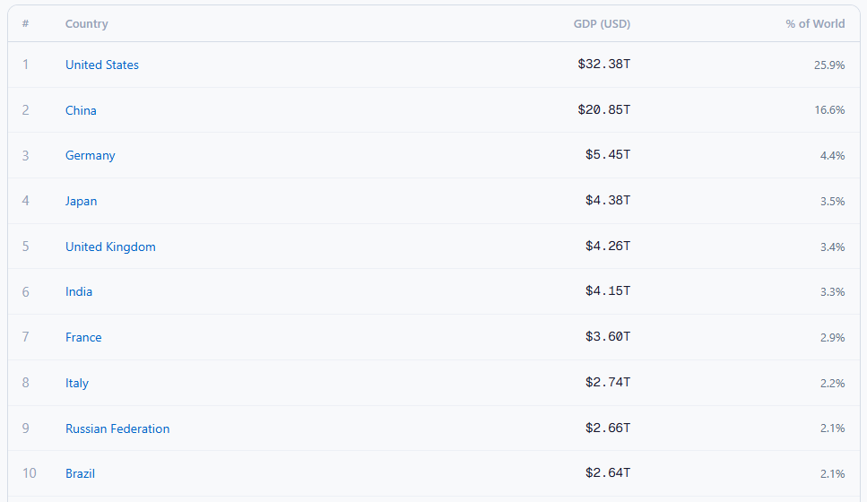
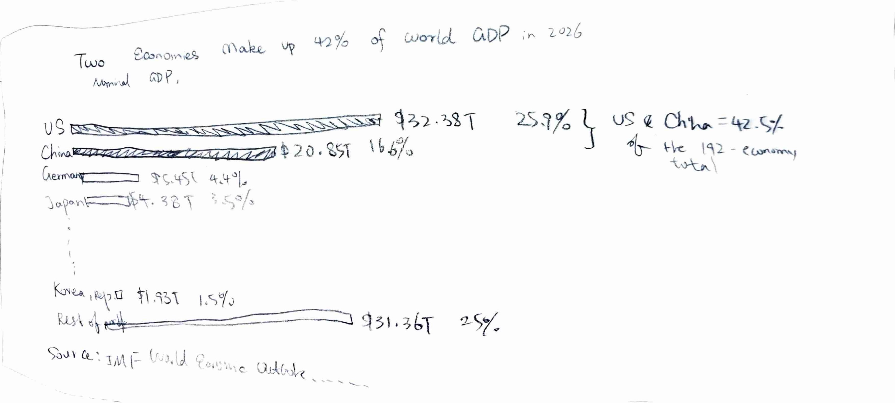
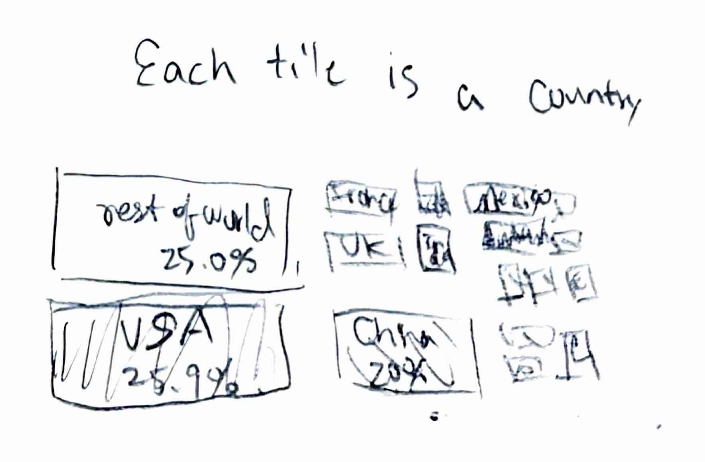

[← Back to portfolio](https://anitah2603.github.io/Huang-Anita-Portfolio/)

# Critique by Design: Who Holds the World's GDP in 2026?

## The original visualization

*Original: a ranked table of countries by GDP (USD) with each country's share of the world total. 
 Source: ([Statistics of the World](https://statisticsoftheworld.com/gdp-by-country)).
 Data: ([IMF World Economic Outlook](https://www.imf.org/en/data)), nominal GDP in current US dollars.
 I found the image source and data on ([MakeoverMonday](https://makeovermonday.vercel.app/dataset/global-gdp-ranks)) website.*

### Why I chose it
Ranked GDP tables are some of the most widely shared economic charts, and the IMF data behind this one is public, so I could recreate it exactly. The table looked clean and easy to read at first. When I opened the underlying dataset, though, I found that it left out a lot of context: the year, whether the figures are projections, and how concentrated world GDP really is. That made it a good candidate for a redesign.

### About the data
The dataset (`IMF_GDP.xlsx`) has 192 economies with rank, ISO code, country name, GDP value in US dollars, and year.

- **Mixed years:** Most values are for **2026, which are IMF projections**, since the year isn't over. Four countries use the latest available year instead: Pakistan, Lebanon and Afghanistan (2025) and Sri Lanka (2024).
- **"% of World":** This is each country's share of the **192-economy total ($125.2T)**. Taiwan is not in the dataset.
- **GDP type:** Figures are **nominal GDP in current US dollars**. They are not adjusted for purchasing power (PPP), so exchange-rate changes can shift the rankings.

## Critique: Stephen Few's Data Visualization Effectiveness Profile

| Criterion | Score (1–10) | Notes |
|---|---|---|
| Usefulness | 6 | Good for quick lookups, but doesn't show the main pattern (concentration) |
| Completeness | 4 | No title, source, year, or GDP type; shows 10 of 192 rows; hides mixed years |
| Perceptibility | 6 | Easy to scan, but a table gives no visual sense of scale |
| Truthfulness | 6 | Numbers are accurate, but projections and mixed years aren't disclosed |
| Intuitiveness | 8 | Everyone knows how to read a ranked table |
| Aesthetics | 6 | Clean and minimal, but bland; low-contrast % column; names look like links |
| Engagement | 3 | Nothing is highlighted, so there's no reason to explore further |

**What worked:** Ranks, right-aligned numbers, and a share column make lookups fast, and the design stays out of the way.

**What didn't:** The table doesn't say where the data comes from, which year it covers, or what kind of GDP it shows. It also turns huge differences into similar-looking strings of digits: "$32.38T" and "$5.45T" take up the same space even though the US economy is about 6× Germany's. The most important insight in the data never comes through: **the US and China together make up 42.5% of the total**, and the top 10 make up 66%.

**Audience:** General readers, students, and journalists who want a quick, trustworthy ranking. The table works for lookups, but it doesn't help anyone understand how the global economy is structured.

### Reflecting on the critique method
Scoring each criterion separately made me look past my first impression. My gut reaction was that the table was "fine." Scoring Completeness and Truthfulness on their own made me open the raw data, which is where I found the mixed years and the projections. The method's limit is that the scores are subjective and some criteria overlap, such as Perceptibility and Intuitiveness. The written notes behind each score ended up more useful than the numbers themselves.

## Wireframes

I sketched two options on paper.

**Option 1: Annotated bar chart (chosen)**

- The title states the takeaway: *"Two economies make up 42% of world GDP in 2026."*
- It shows the top 15 economies plus one "Rest of world" bar.
- The US and China are highlighted, and a bracket annotation gives their combined share.
- Each bar shows both its dollar value and its share.

**Option 2: Treemap (part-to-whole)**

- Tile area represents each economy's share of the total.

I chose the bar chart as the final design. People compare bar lengths more accurately than tile areas, and the bars still make the concentration story obvious.

## User feedback

I shared the wireframes with two people and asked them:
1. What is the main message of this chart?
2. Is anything confusing or missing?
3. Which version, bar chart or treemap, communicates the data better, and why?

**Person 1 ([role, e.g. classmate]):**
- I really like the bar chart because it gives a straight forward linear comparison of the economies values. The treemap looks cool but i kind of loose track of the sizes of the smaller economies.

**Person 2 ([role]):**
- I think its a good idea to add both dollar values and percentage label to the bar chart, and I would like to know how many countries does the "rest of the world" bar actually counts. For the treemap, I think its a little bit difficult to compare the actual sizes of the economies. For example, China should be two thirds of the US based on the percentage you list, but here it looks like they are the same.

**What I learned and changed:**
- A true to scale bar charts could reflect the portion of the economies better than a treemap, especailly with clear labels of GDP amount in US dollars and percenatages.
- Make clear labels of the number of countries, their representing values, and data sources.

## The redesign

<iframe src="https://public.tableau.com/views/GDPof192economiesin2026/Sheet1?:showVizHome=no&:embed=true" width="100%" height="700" frameborder="0"></iframe>

[View the interactive version on Tableau Public](https://public.tableau.com/app/profile/anita.huang4128/viz/GDPof192economiesin2026/Sheet1)

### What I did differently

| Problem in the original | How the redesign addresses it |
|---|---|
| No title or takeaway | The title states the main insight: two economies make up 42.5% of world GDP |
| No year, source, or GDP type | Subtitle and source line give the year, nominal current US$, and IMF source |
| Table hides differences in scale | Bar lengths show scale directly (US ≈ 6× Germany) |
| Only 10 of 192 economies shown | Top 15 plus a "Rest of world (177 economies)" bar, so the total is represented |
| No emphasis | The US and China are highlighted in blue and everything else is gray, so color carries the message |
| "% of World" not explained | Annotation and notes define the share as % of the 192-economy total |

### Process
1. Explored the raw dataset in Excel and found the mixed years, the projections, and the concentration pattern.
2. Scored the original with Few's effectiveness profile.
3. Sketched two wireframes and collected feedback.
4. Built the chart in Tableau Public using calculated fields:
   - `Group`: combines every economy ranked below 15 into "Rest of world"
   - `Share`: each bar's % of the 192-economy total, using a FIXED level-of-detail calculation
   - `Highlight`: colors the US and China differently from the rest
5. Sorted the bars by IMF rank, added labels showing dollars and share, removed gridlines, and annotated the US–China share.

### Key insight
Global GDP is highly concentrated. The US (25.9%) and China (16.6%) together account for 42.5% of the total. The remaining 177 economies outside the top 15 add up to about the same as the US alone (25.0%).

## AI acknowledgements
I used Claude's guidance to create my Tableau visualization. I sent him my bar chart sketch, the original dataset, and a list of the visualizations I wanted to create. I wanted to highlight parts of the bars, rank the top 15 economies and the rest of the world, and add comments next to the U.S. and China's bars. Then, I edited the Tableau interface based on Claude's instructions on my own.

[← Back to portfolio](https://anitah2603.github.io/Huang-Anita-Portfolio/)
